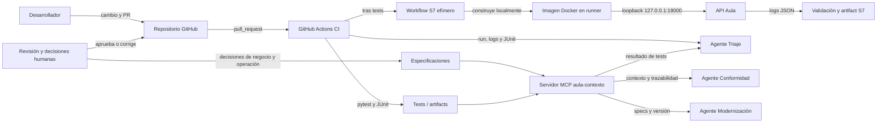

# Defensa S8 — Laboratorio Agentic DevOps

## Alcance y criterio de evidencia

Esta defensa describe el estado comprobable del repositorio `laboratorio-aula` en el worktree `aula-modernizacion`. El estado `sellada` de `.aula/progreso.json` es un dato del CLI local; no sustituye un resultado de CI, una prueba funcional ni una confirmación de configuración remota. Se separan por ello implementación, verificación automática y validación funcional. Los enlaces a GitHub identifican la evidencia externa citada por la documentación del laboratorio; no implican que se haya vuelto a consultar el servicio durante esta revisión.

### Matriz de trazabilidad S0–S7

| Etapa | Problema abordado | Solución implementada | Verificación automática | Validación funcional/evidencia | Estado defendible |
|---|---|---|---|---|---|
| S0 — Bootstrap | Faltaban controles básicos de contribución y CI no ejecutaba pytest. | Workflow CI, `CODEOWNERS`, plantilla de PR y tests de estructura. | `tests/test_s0.py` comprueba estructura; `ci.yml` contiene jobs de tamaño, commits y tests. El progreso local marca S0 sellada. | La bitácora registra la corrección del job. No se pudo confirmar desde esa sesión el estado de PR ni Actions por falta de autenticación `gh`; tampoco acredita que la protección de rama remota esté activa. | Implementación local presente; verificación remota y reglas de rama pendientes de confirmación. |
| S1 — Rebanada vertical | Necesidad de una aplicación ejecutable con API y empaquetado. | Dominio de matrícula/expediente, API, Docker multi-stage y flujo de publicación. | Suite de tests de API/dominio y workflows de imagen/publicación. | La bitácora registra comprobaciones locales de build, `/salud` y `POST /matriculas`; cita la [ejecución de publicación 38759020775](https://github.com/David-Omenaca-NTT/laboratorio-aula/actions/runs/38759020775). La reconstrucción de 4 h 40 min es provisional, no comparable como línea base sin agentes. | Aplicación y empaquetado presentes; publicación citada. Duraciones provisionales. |
| S2 — SDD | Ambigüedades de negocio y pérdida de trazabilidad entre requisito y test. | `SPEC-001` y `SPEC-002`, decisiones explícitas y etiquetas `cubre:` en tests. | Tests y herramienta MCP `trazabilidad` correlacionan criterios con tests. | La bitácora explica decisiones como asignaturas repetidas/convalidadas e invariantes de matrícula; no consta aprobación externa del mentor. | Especificaciones y pruebas presentes; validación externa de decisiones no acreditada. |
| S3 — Contexto | El agente necesita límites y contexto versionados. | Instrucciones y controles locales versionados; documentación de contexto. | Verificador de la estación y controles/hook del repositorio. | La comparativa Claude Code/OpenCode y el ciclo Orca escritor/revisor están expresamente documentados como hipotéticos o simulados, no como mediciones de ejecución. | Controles locales documentados; comparativas simuladas. |
| S4a — Agente propio | Interpretación repetible de conformidad sin depender de un LLM. | Agente determinista de Conformidad y evaluador offline. | Tests y conjunto dorado. Un informe posterior registra métricas perfectas; un informe histórico registra recall 0,1. | Informes persistidos en `evals/informes/`; son muestras finitas de evaluación, no garantía para entradas futuras ni aprobación de PR. | Implementación y evaluación existentes; calidad general no se extrapola de los casos dorados. |
| S4b — Flotilla/MCP | Separar responsabilidades y exponer capacidades acotadas a herramientas. | Agentes Conformidad, Modernización y Triaje; servidor MCP stdio con cinco herramientas declaradas. | Tests de agentes/MCP y evaluaciones offline. `version_plan` está declarada pero su implementación lanza `NotImplementedError`; no presentarla como funcional. | Informes dorados de 15/16/12 casos para Conformidad/Triaje/Modernización, respectivamente; resultados acotados a esos corpus. | Tres agentes deterministas presentes. MCP ofrece herramientas implementadas, con la limitación indicada. |
| S5 — Legado | Modernizar sin perder comportamiento observable. | Caracterización, comparación de equivalencia y registro de desviaciones en `DESVIACIONES.md`. | Tests de caracterización/equivalencia y verificador S5. | Hay corpus y resultados locales persistidos; no equivalen a demostrar equivalencia para todo uso o entorno. | Proceso verificable para el alcance caracterizado; generalización limitada al corpus y casos probados. |
| S6 — Gobierno | Definir alcance, permisos, versiones y evaluación de agentes. | Manifiestos ARM, hashes, caducidad, workflow `gate-manifiesto.yml`, controles locales y análisis OWASP. | Validación de estructura/hash/vigencia de manifiestos; workflows y tests existentes. Progreso local marca S6 sellada. | Los workflows analizados usan principalmente permisos de lectura. La protección remota de rama, revisión obligatoria y algunos límites del contrato no están demostrados como controles técnicos. | Gobierno parcial implementado y verificable; no es una certificación de seguridad empresarial. |
| S7 — Despliegue/Triaje | Comprobar servicio temporal, observabilidad y diagnóstico de fallos de CI. | Workflow efímero local al runner, smoke tests, captura de evidencia y Triaje v2 basado en JUnit. | CI despliega después de tests; ejecuta `/salud`, `POST /matriculas`, valida observabilidad y publica artifacts por 14 días. | [Run experimental 44546344178](https://github.com/David-Omenaca-NTT/aula-triaje/actions/runs/44546344178): 111 tests, 105 correctos, 6 fallidos, 0 errores; JUnit disponible y clasificación `tests`. Rollback efectivo y MTTR no medidos. | Detección, recuperación de evidencia y clasificación validadas; rollback/MTTR pendientes. |

## 1. PROBLEMA — ¿Qué queríamos resolver?

Un equipo que desarrolla sin especificaciones verificables puede producir código que compila y, aun así, interpreta de forma distinta una regla de negocio. S2 hizo visible este problema: el significado de asignaturas repetidas, convalidadas y del bloqueo de matrícula necesitó decisiones explícitas antes de fijar las pruebas. La bitácora deja constancia de decisiones sin aprobación externa acreditada; eso recuerda que una decisión documentada no equivale automáticamente a una decisión aceptada por el negocio.

Automatizar sin controles aumenta el alcance de un error. En este repositorio se introdujeron manifiestos ARM que declaran herramientas, datos, autonomía y restricciones de los agentes, junto con workflows de lectura y validación de manifiestos. La documentación de S6 reconoce límites: el estado de protección de rama y algunas revisiones humanas remotas no están comprobados, y los controles declarativos no garantizan por sí solos aislamiento efectivo.

CI/CD también necesita diagnóstico, no solo un semáforo. En el experimento original de S7, CI encontró seis tests fallidos, pero Triaje no recuperó el artifact JUnit; informó `pytest_disponible: false`, clasificó `cobertura_spec` y propuso un handoff incorrecto a Conformidad. La corrección de Triaje v2 priorizó evidencia estructurada y permitió clasificar el incidente como fallo de tests.

La motivación para introducir agentes fue explorar cómo automatizar análisis repetibles con trazabilidad y límites, manteniendo el control humano en decisiones de negocio, aprobación de cambios y operaciones sensibles. En el estado actual son agentes deterministas offline: no hay inferencia de LLM en sus implementaciones, por lo que este laboratorio no prueba todavía la seguridad de agentes basados en modelos.

## 2. SPEC — ¿Cómo definimos lo correcto?

Spec-Driven Development (SDD) convierte una necesidad en una especificación con alcance, criterios de aceptación (CA) e invariantes antes de implementar. Las ambigüedades deben resolverse expresamente y las decisiones quedan registradas. Después, cada test relevante identifica qué criterio cubre mediante etiquetas `cubre:`. La herramienta MCP `trazabilidad` compara los identificadores de las especificaciones con esas etiquetas y presenta criterios cubiertos y sin cubrir.

Un recorrido real es `SPEC-001/INV-03`, relativo al plan aplicado y su versión en una matrícula. La [bitácora S2](../S2-sdd/bitacora.md) registra la decisión: ambos se pueden cambiar antes de confirmar; tras la primera confirmación el bloqueo persiste, incluso si luego se anula. La regla aparece en [SPEC-001](../../specs/SPEC-001-matricula.md), tests etiquetados `cubre: SPEC-001/INV-03`, y la CI ejecuta `tests/` con pytest y publica JUnit. La automatización puede demostrar que esos tests pasan para el SHA evaluado y que existe una etiqueta de trazabilidad; no demuestra que la regla de negocio sea correcta ni que cada requisito posible esté cubierto. Esa conformidad requiere revisión humana de la especificación y de la adecuación de las pruebas.

La evidencia de cumplimiento debe conservar contexto reproducible: especificación, test, SHA, resultado CI y, cuando corresponda, artifact. En S7, Triaje v2 recupera JUnit y clasifica a partir del resultado estructurado; una referencia textual a `SPEC-002` no basta para concluir que hay una brecha de cobertura.

## 3. ARQUITECTURA — ¿Qué hemos construido?

La aplicación ofrece una API de matrícula y expediente sobre un dominio Python. Las especificaciones y tests viven en Git; las Pull Requests activan GitHub Actions. La CI comprueba tamaño de diff, mensajes de commit, tests/cobertura y, si corresponde, conformidad. El flujo de S7 construye una imagen Docker en el runner y sirve el proceso únicamente en loopback `127.0.0.1:18000`; la imagen no se publica desde ese workflow.

El servidor MCP `aula-contexto` transporta herramientas por stdio/JSON-RPC. Las cinco herramientas declaradas son `listar_specs`, `obtener_spec`, `trazabilidad`, `resultado_tests` y `version_plan`; esta última permanece sin implementar. Conformidad analiza especificación, diff, tests y trazabilidad; Triaje recupera metadatos/logs y JUnit del run fallido y clasifica la evidencia; Modernización evalúa caracterización, equivalencia, alcance y desviaciones. Los agentes actuales son deterministas, no editan ni publican cambios por sí mismos. No se infiere que todas las capacidades declaradas en contratos sean efectivas si el código o workflow no las demuestra.

El diagrama representa relaciones declaradas por los workflows y herramientas del repositorio; no implica integración con plataformas corporativas. La intervención humana conserva la decisión sobre requisitos, revisión/merge y cualquier operación fuera del runner. Los manifiestos declaran límites y el gate valida sus datos, pero la protección remota de ramas no se considera probada aquí.

## 4. MÉTRICAS — ¿Cómo sabemos que funciona?

### Evidencias disponibles y límites

- La CI ejecuta `tests/`, exige cobertura de dominio superior al umbral configurado (`--cov-fail-under=61`) y publica `pytest-results.xml` con retención configurada de 14 días. La existencia de esa configuración no prueba una cifra de cobertura concreta para cada run.
- S4 guarda evaluaciones offline con corpus finitos. Los informes recientes citados por S6 registran 15 casos para Conformidad, 16 para Triaje y 12 para Modernización. Algunos informes muestran métricas de precisión/recall/F1 de 1.0; existe también un informe histórico de Conformidad con recall 0.1. No son una garantía estadística general ni resultados de producción.
- S6 valida presencia, estructura, hash y vigencia de manifiestos. El valor de coste 0.0 de los evaluadores es declarado por diseño offline, no medición de coste total.
- S7 instrumenta logs JSON, `correlation_id` y el evento `matricula.created`; la validación del despliegue comprueba las evidencias de observabilidad. No hay aquí una serie de volumen o latencia de producción.
- MTTR no se ha medido: [mttr.md](../S7-despliegue/mttr.md) conserva ambas rondas como «Pendiente de medición».

### Caso obligatorio: experimento de Triaje v2

El [run 44546344178](https://github.com/David-Omenaca-NTT/aula-triaje/actions/runs/44546344178) está documentado con estos resultados:

| Indicador | Resultado | Interpretación |
|---|---:|---|
| Tests ejecutados | 111 | Suite reportada por CI |
| Correctos | 105 | Sin fallo en esos casos |
| Fallidos | 6 | Fallos detectados por pytest |
| Errores / omitidos | 0 / 0 | Según el JUnit recuperado |
| JUnit disponible | `true` | Artifact recuperado por Triaje v2 |
| Clasificación | `tests` | Coherente con los fallos estructurados |
| `spec_id` / `handoff` | `null` / `null` | No concluyó que fuera un problema de cobertura |

El defecto controlado sustituyó una división por una multiplicación en `nota_media_ponderada()`, produciendo seis fallos. Triaje v1 no recuperó JUnit: `pytest_disponible: false`, clasificación `cobertura_spec` y handoff a Conformidad. Tras la corrección integrada por [PR #44](https://github.com/David-Omenaca-NTT/aula-triaje/pull/44), [commit de merge `f9a2a3061e66d518d7ba6532ca86115db541993a`](https://github.com/David-Omenaca-NTT/aula-triaje/commit/f9a2a3061e66d518d7ba6532ca86115db541993a), la validación integrada recuperó JUnit y clasificó `tests`. La evidencia demuestra detección, recuperación de evidencia y clasificación; no demuestra rollback, recuperación del servicio ni MTTR.

## 5. GOBIERNO — ¿Cómo mantenemos el control?

Los controles encontrados son una plantilla de PR, `CODEOWNERS`, validaciones de tamaño y Conventional Commits en CI, tests/cobertura, workflows de permisos explícitos de lectura, manifiestos ARM versionados, hashes/caducidad, restricciones locales de rutas y validación de manifiestos. Las Pull Requests forman el mecanismo documentado de revisión. La existencia de `CODEOWNERS` no demuestra que esté activada una regla remota que exija su aprobación; la protección de rama y la aprobación obligatoria siguen pendientes de confirmación.

La separación entre ramas experimentales y código confiable debe aplicarse mediante revisión y reglas de repositorio, pero su configuración remota no está acreditada por los archivos locales. El workflow efímero evita publicar la imagen y limita el puerto a loopback del runner. En cambio, hay workflows separados de publicación; el control para evitar una publicación accidental requiere verificar sus disparadores, permisos y protecciones de entorno en GitHub. No se presenta ese aislamiento organizativo como garantía completa.

| Riesgo Agentic DevOps | Control real observado | Riesgo residual / pendiente |
|---|---|---|
| Acceso excesivo a herramientas | Manifiestos enumeran herramientas/datos; workflows analizados usan permisos de lectura; responsabilidades separadas. | Contratos pueden declarar capacidades no implementadas o no forzadas. Revisar permisos efectivos y secretos del entorno. |
| Instrucciones/entradas no confiables | Agentes deterministas; Modernización valida rutas; restricciones locales/hook sobre rutas protegidas. | No hay defensa general ante entradas adversariales ni sandbox completo demostrado. Si se introduce LLM, hará falta threat model nuevo. |
| Automatización de cambios incorrectos | Los agentes analíticos emiten veredictos; la CI aporta gates y el flujo de PR permite revisión. | La revisión obligatoria y branch protection remotas no están demostradas; no confiar en un veredicto aislado. |
| Diagnóstico falso | Triaje v2 recupera e interpreta JUnit estructurado y dispone de corpus de evaluación. | El fallo inicial prueba que la recuperación de artifacts y las heurísticas pueden fallar; las evaluaciones doradas son finitas. |
| Publicación accidental | El despliegue S7 no publica imagen; construye en runner y limpia contenedor/imagen. | Otros workflows publican artefactos/imágenes; sus controles remotos de aprobación y alcance deben revisarse antes de uso empresarial. |
| Evidencia manipulada o caducada | Manifiestos incorporan hash y caducidad; CI publica artifacts con retención limitada. | Integridad/retención no equivale a archivo inmutable; protección integral de informes y artifacts no está demostrada. |

Los agentes no reemplazan scripts cuando la tarea es estable y mecánica: se usan para interpretar evidencia con un contrato y salida estructurada. En operaciones sensibles, el patrón seguro requiere que la automatización observe y proponga, mientras una persona autoriza el cambio. Los permisos mínimos son efectivos solo cuando se verifican en la configuración del proveedor, no por el manifiesto únicamente.

## 6. COSTE — ¿Cuánto cuesta operar el patrón?

| Categoría | Dato verificable | Estimación/estado |
|---|---|---|
| Modelos IA | Los agentes actuales son deterministas y no llaman a LLM/API. Los evaluadores y ARM declaran coste de agente 0.0 USD por ejecución. | Componente de inferencia actual: 0 por diseño, no factura ni coste total. Si se añade modelo, falta medir tokens, tarifa, reintentos y evaluación. |
| GitHub Actions / CI | Workflows ejecutan jobs y suben artifacts; S7 conserva evidencia 14 días. | Minutos facturados y número de ejecuciones no están instrumentados en los documentos revisados. Coste no calculable sin uso, runner y tarifa aplicable. |
| Almacenamiento | Artifact JUnit y artifact S7 tienen retención configurada de 14 días. | Volumen, consumo facturado y coste de almacenamiento no disponibles. |
| Infraestructura de aplicación | S7 crea imagen/contendor temporal dentro del runner y los elimina al finalizar. | No hay infraestructura persistente de S7; el coste del runner está incluido en la categoría CI y no medido. |
| Mantenimiento | Existe bitácora, tests, corpus dorados, manifiestos y workflows que mantener. | Horas/persona y coste laboral no están medidos. S1 contiene 4 h 40 min provisionales reconstruidas, no una línea base comparable. |
| Revisión humana | PR y CODEOWNERS están presentes en el repositorio. | Duración, volumen y coste de revisión no registrados. |

Una estimación empresarial defendible necesita primero medir volumen de PR/runs, minutos por workflow y tipo de runner, almacenamiento por artifact, intervenciones de modelos (si se incorporan), y horas de revisión/mantenimiento. Se aplican después las tarifas reales del contrato y se divide el coste atribuible entre resultados verificables, por ejemplo CA cubiertos y validados para el mismo SHA. No asigno precios externos ni extrapolo los valores declarados de 0.0 USD al coste operativo total.

El patrón puede ser viable a escala empresarial si aporta valor medible frente a su operación: límites de autonomía proporcionales, identidad y secretos gestionados centralmente, permisos mínimos comprobados, auditoría correlacionable, retención adecuada, evaluación continua, límites de consumo, aprobación humana en acciones sensibles y un coste por unidad de resultado conocido. Estos son requisitos de adopción, no capacidades empresariales ya demostradas por el laboratorio.

## Traducción del patrón a la torre de destino

La torre tecnológica empresarial de destino no está documentada en el repositorio. No se asignan equivalentes por marca o producto; la columna de destino queda abierta hasta que el propietario de la torre confirme sus componentes y estándares.

| Componente del laboratorio | Capacidad que aporta | Equivalente en la torre de destino | Adaptaciones necesarias |
|---|---|---|---|
| GitHub Actions | CI/CD de PR, tests, artifacts y despliegue temporal | Por determinar con el equipo de plataforma | Integrar repositorios, identidad, runners, redes, aprobaciones, secretos, auditoría, retención y coste corporativos. |
| MCP `aula-contexto` | Acceso controlado mediante herramientas de lectura a specs, trazabilidad y resultados | Por determinar; confirmar si la torre admite MCP o exige otro contrato | Autenticación/autorización, allowlist de herramientas, aislamiento, registro de llamadas, límites de tiempo/datos y control de salida. |
| Triaje | Diagnóstico estructurado de runs fallidos usando logs/JUnit | Por determinar con operaciones/observabilidad | Correlación con la fuente corporativa de CI, evidencias firmadas o verificables, gestión de identidades y aprobación humana antes de remediar. |
| Manifiestos ARM | Declaración versionada de capacidades, datos, propietario y límites | Por determinar con gobierno de IA/plataforma | Alinear esquema con políticas corporativas, auditoría, aprobaciones, caducidad y enforcement técnico. |
| Observabilidad | Logs JSON, `correlation_id`, evento de negocio y artifacts temporales | Por determinar con observabilidad corporativa | Adaptar formato, transporte, privacidad, retención, red y consulta; validar consistencia extremo a extremo. |
| Despliegue efímero | Construcción local en runner, loopback y limpieza | Por determinar con plataforma de ejecución | Definir aislamiento, imágenes, escaneo, egress, cuotas, destrucción garantizada y no publicación por defecto. |

Antes de trasladar el patrón hay que resolver propietario de la torre, proveedor de identidad/secretos, red y conectividad, requisitos de auditoría/cumplimiento, lugar de aprobación humana, restricciones de ejecución y tarifas. Propuesta incremental y reversible:

1. Acordar un caso de uso de solo lectura y mapear componentes/identidades con el equipo de torre.
2. Ejecutar un piloto aislado con repositorio de prueba, sin secretos de producción ni permisos de escritura; conservar artifacts y auditar cada invocación.
3. Medir precisión, falsos diagnósticos, latencia, minutos, almacenamiento y tiempo de revisión frente a una línea base humana.
4. Incorporar controles de identidad, permisos, aprobación y rollback probados en un entorno no productivo antes de cualquier ampliación.
5. Ampliar por equipo solo tras revisión de seguridad/cumplimiento y decisión explícita de coste/beneficio; mantener un interruptor para deshabilitar la integración y volver al proceso manual.

## Qué decisión cambiaría hoy

Cambiaría la decisión de Triaje v1 de inferir la categoría principalmente a partir de texto de logs y referencias a especificaciones. Parecía razonable porque una mención a `SPEC-002` en un fallo podía sugerir que faltaba cobertura. La evidencia mostró que la señal textual no distinguía la causa: CI había detectado seis tests fallidos, pero el agente no recuperó JUnit, informó `pytest_disponible: false`, clasificó `cobertura_spec` y derivó incorrectamente a Conformidad.

Desde el principio exigiría que Triaje primero obtenga el resultado estructurado de pytest/JUnit y valide su disponibilidad y coherencia. Solo después usaría texto como contexto auxiliar, conservando explícitamente la incertidumbre si la evidencia falta o no es válida. La corrección de v2 añadió repositorio explícito para descargar el artifact, diagnóstico estructurado de errores, pruebas de regresión y validación de manifiestos; PR #44 quedó integrada en el commit de merge enlazado arriba.

El coste observable fue una iteración correctiva y un diagnóstico/handoff equivocado en el experimento original. No hay medición de horas, coste monetario ni impacto operativo que permita cuantificarlo. En una empresa, una clasificación errónea podría dirigir una incidencia al equipo equivocado, retrasar la respuesta o provocar un cambio innecesario; por eso el diagnóstico no debe ejecutar una remediación autónoma sin evidencia y autorización.

La solución actual tampoco es infalible: depende de la disponibilidad y retención del artifact, de una interpretación correcta del XML y de una cobertura de regresión finita. Puede fallar ante artifacts ausentes, formatos distintos, errores de permisos o casos fuera del corpus. La prioridad es evidencia estructurada verificable sobre inferencia textual, con salida explícita de “evidencia insuficiente” y revisión humana cuando corresponda.

## Anexo — Preguntas difíciles del panel

1. **¿Por qué utilizar agentes en lugar de scripts tradicionales?** Para tareas de análisis que combinan contexto —por ejemplo, clasificar evidencia de CI o contrastar cambios con una spec— y producir un veredicto estructurado. La lógica actual es determinista; para pasos mecánicos simples un script sigue siendo suficiente.
2. **¿Qué sucede cuando el agente se equivoca?** La CI y los tests siguen siendo gates independientes. El caso Triaje v1 documenta una clasificación incorrecta; la corrección mejoró la recuperación de JUnit. No se permite tomar esa clasificación como prueba de recuperación ni como autorización de despliegue.
3. **¿Cómo se evita que un agente modifique producción?** En este laboratorio los agentes analíticos no modifican código ni despliegan producción; Triaje trabaja con permisos de lectura y S7 es efímero en loopback. La protección remota completa de ramas/entornos no está demostrada y debe verificarse antes de operar en empresa.
4. **¿Cómo se comprueba que una especificación está cubierta?** Se relacionan identificadores de CA/INV con etiquetas `cubre:` en tests, la herramienta `trazabilidad` los enumera y CI ejecuta pytest para un SHA. La etiqueta no demuestra por sí sola que la prueba sea adecuada; hace falta revisión.
5. **¿Por qué utilizar MCP?** Ofrece un contrato común de herramientas para consultar especificaciones, trazabilidad y resultados de tests. La implementación propia es stdio/JSON-RPC; no acredita interoperabilidad empresarial ni que todas las herramientas declaradas estén completas (`version_plan` está pendiente).
6. **¿Qué garantiza que las evidencias no se inventan?** Nada por sí solo. Los enlaces, JUnit y logs permiten contrastar resultados; el parser de Triaje usa JUnit estructurado y los artifacts tienen retención definida. La integridad inmutable de extremo a extremo no está demostrada.
7. **¿Cómo escalaría el patrón a varios equipos?** Con contratos de agente versionados, identidad y permisos centralizados, corpus de evaluación por dominio, auditoría común, ownership claro y pilotos incrementales. La torre destino y sus equivalentes aún deben determinarse.
8. **¿Cuál es el coste operativo?** El componente LLM actual es cero por diseño porque no hay llamadas a modelo. Minutos de Actions, almacenamiento facturado, mantenimiento y revisión humana no están medidos; el coste total no se puede afirmar todavía.
9. **¿Qué cambiarías si empezaras hoy?** Diseñaría Triaje alrededor de resultados estructurados como JUnit desde el principio y trataría el texto solo como contexto auxiliar, con manejo explícito de evidencia ausente.
10. **¿Qué parte no está lista para producción?** No están demostrados rollback efectivo ni MTTR; la configuración remota de branch protection/aprobaciones requiere confirmación; MCP tiene una herramienta sin implementar; y faltan integración, seguridad, coste e identidad de la torre empresarial.
